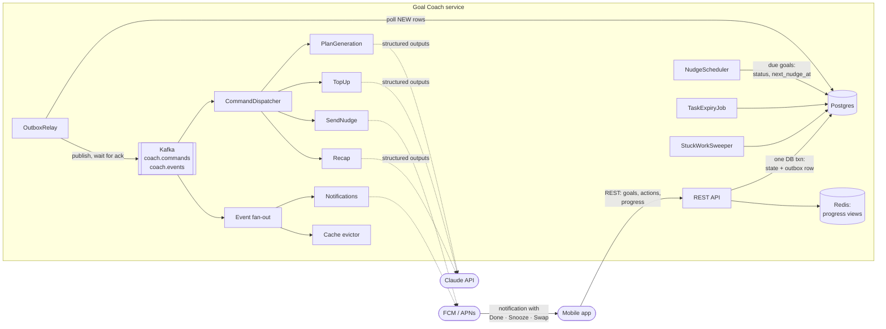
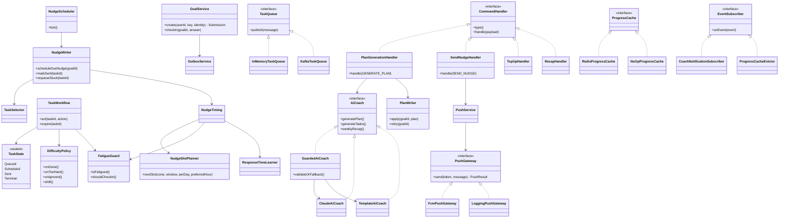
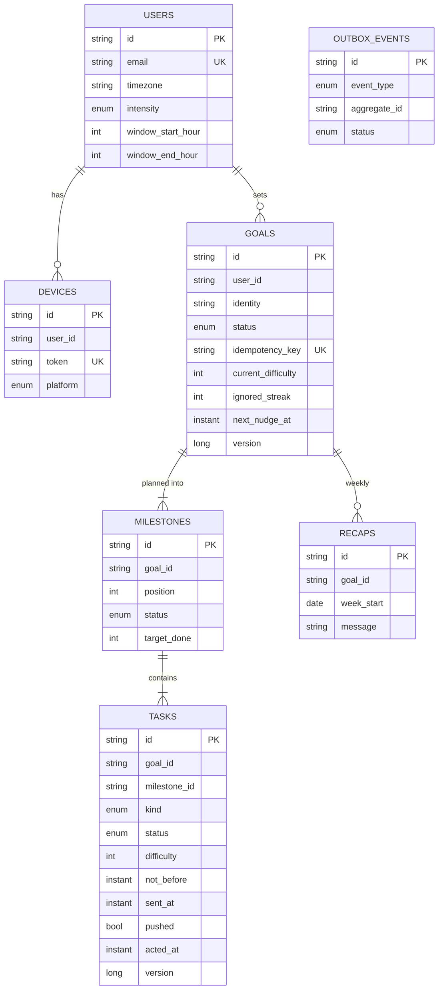
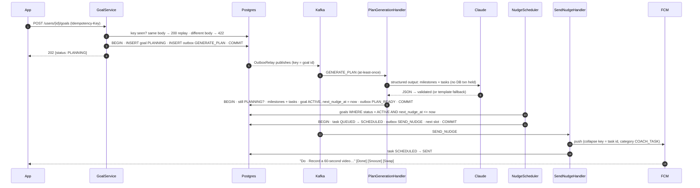
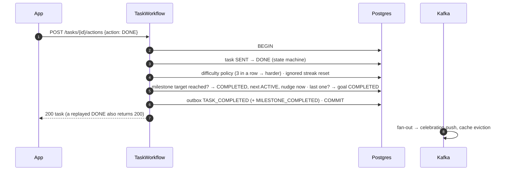
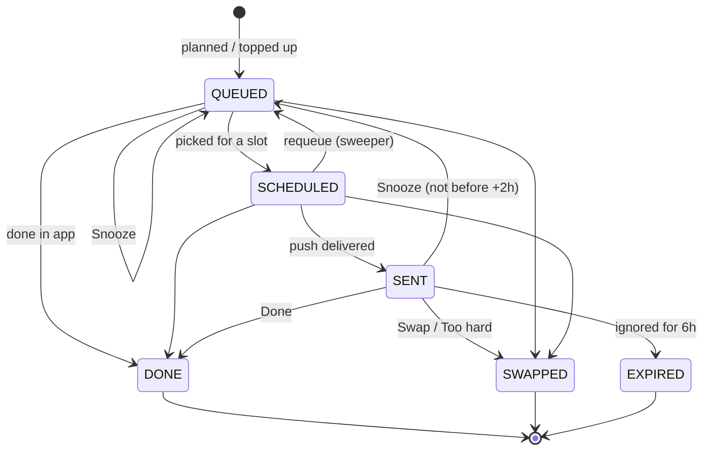

# Goal Coach Service

[](https://github.com/viren97/goal-coach-service/actions/workflows/ci.yml)


**Tell the app who you want to become. It plans the path, nudges you with one small action at a time, and adapts as you go.**

Goal Coach is the backend for an identity-based coaching app. A user sets a goal as an identity
("a confident public speaker", "a runner", "a senior backend engineer"). Claude turns it into milestones
and bite-sized tasks. The service sends those tasks as push notifications at the times the user actually
responds, and tracks streaks and progress. It makes tasks harder or easier based on what the user does,
and backs off before the user mutes it.

The core is a set of reliability patterns that are easy to get wrong: transactional outbox, idempotent
consumers, a state machine per task, optimistic locking, crash recovery, and AI calls that can fail
without breaking anything. It runs with **zero setup** (SQLite, in-memory queue, template AI), or as the
full stack (Postgres, Kafka, Redis, Claude, Firebase) with one `docker compose up`.

**Stack:** Java 17 · Spring Boot 3.5 · Spring Data JPA · Postgres (SQLite locally) · Kafka · Redis ·
Anthropic Java SDK (Claude) · Firebase Cloud Messaging · Docker Compose · Helm · GitHub Actions

---

## Contents

- [The product loop](#the-product-loop)
- [Quick start](#quick-start)
- [Try it in 60 seconds](#try-it-in-60-seconds)
- [Architecture (HLD)](#architecture-hld)
- [Low-level design (LLD)](#low-level-design-lld)
- [Key flows](#key-flows)
- [Task state machine](#task-state-machine)
- [Coaching logic](#coaching-logic)
- [Failure handling](#failure-handling)
- [Design choices and trade-offs](#design-choices-and-trade-offs)
- [Configuration](#configuration)
- [Testing](#testing)
- [Project layout](#project-layout)
- [Extending](#extending)
- Docs: [API](docs/API.md) · [AI integration](docs/AI.md) · [Deployment & secrets](docs/DEPLOYMENT.md) · [Roadmap](docs/ROADMAP.md)

---

## The product loop

| Step | What happens | Where in the code |
|---|---|---|
| **1. Define** | The user states the identity they want and picks an intensity (1–3 nudges a day) and a send window | `user`, `goal/GoalService` |
| **2. Plan** | Claude produces 3–5 milestones with 4–6 tasks each in one structured-output call. The output is validated, with a deterministic fallback | `goal/PlanGenerationHandler`, `ai/*` |
| **3. Nudge** | At the next slot in the user's local time, one task is pushed with **Done / Snooze / Swap** buttons | `nudge/*`, `push/*` |
| **4. Act** | One tap completes, snoozes or swaps the task. "Too hard" swaps it for an easier one | `task/TaskWorkflow` |
| **5. Adapt** | Three completions in a row make tasks harder; ignoring or "too hard" makes them easier; repeated ignoring triggers a back-off and a check-in | `task/DifficultyPolicy`, `nudge/FatigueGuard` |
| **6. Progress** | Streaks, identity score, milestone progress, push → action rate, and an AI-written weekly recap | `progress/*`, `recap/*` |

## Quick start

**Prerequisites:** Java 17. Docker is only needed for the full stack.

**No Docker at all** (SQLite file, in-memory queue, template AI, pushes written to the log)
```bash
./gradlew bootRun                  # API on http://localhost:8080, creates ./coach.db
./gradlew test                     # 36 unit + end-to-end tests
```

**Full stack** (Postgres, Kafka, Redis, app)
```bash
docker compose up --build          # API on http://localhost:8080, health on /actuator/health
```

**With real Claude plans**
```bash
COACH_AI_PROVIDER=claude ANTHROPIC_API_KEY=sk-ant-... ./gradlew bootRun
```

**Infra in Docker, app from your IDE**
```bash
docker compose up -d postgres redis kafka
SPRING_PROFILES_ACTIVE=docker DB_URL=jdbc:postgresql://localhost:5432/coach DB_PASSWORD=coach-local-only \
  KAFKA_BOOTSTRAP_SERVERS=localhost:29092 REDIS_HOST=localhost ./gradlew bootRun
```

| Profile | Database | Queue | Progress cache | Use |
|---|---|---|---|---|
| default | SQLite (1 connection) | in-memory | off | local runs, tests |
| `docker` | Postgres (pool 20) | Kafka | Redis | docker-compose, Kubernetes |

| Adapter switch | Values | Default |
|---|---|---|
| `COACH_AI_PROVIDER` | `template` (deterministic, no key) · `claude` | `template` |
| `COACH_PUSH_PROVIDER` | `log` · `fcm` | `log` |

## Try it in 60 seconds

```bash
B=localhost:8080/api/v1

# 1. A user who can be nudged at any hour, twice a day
USER=$(curl -s -X POST $B/users -H 'Content-Type: application/json' \
  -d '{"name":"Asha","email":"asha@example.com","timezone":"Asia/Kolkata","intensity":"STEADY","windowStartHour":0,"windowEndHour":24}' \
  | sed -E 's/.*"id":"([^"]+)".*/\1/')

# 2. Register a push token (from the mobile app's FCM SDK)
curl -s -X POST $B/users/$USER/devices -H 'Content-Type: application/json' -d '{"token":"demo-token","platform":"ANDROID"}'

# 3. Set the goal. 202 Accepted: the plan is generated in the background
GOAL=$(curl -s -X POST $B/users/$USER/goals -H 'Content-Type: application/json' -H 'Idempotency-Key: onboarding-1' \
  -d '{"identity":"a confident public speaker"}' | sed -E 's/^\{"id":"([^"]+)".*/\1/')

sleep 2 && curl -s $B/goals/$GOAL          # ACTIVE, with 3 milestones
# Within 30s the first nudge appears in the log:  [push ANDROID demo-tok…] Learn · Read one short article ...
curl -s $B/goals/$GOAL/today               # today's task
curl -s -X POST $B/tasks/<taskId>/actions -H 'Content-Type: application/json' -d '{"action":"DONE","note":"Practised in the mirror"}'
curl -s $B/goals/$GOAL/progress            # streak 1, identity score, milestone progress
```

Every endpoint is documented with examples in [docs/API.md](docs/API.md).

---

## Architecture (HLD)



- **Writes are fast, AI and push are async.** Creating a goal stores the goal and a `GENERATE_PLAN`
  outbox row in one transaction and returns `202`. The slow parts (Claude, FCM) run in workers that
  never hold a DB transaction.
- **No dual writes.** Every state change commits together with the command or event that follows it
  (transactional outbox). A relay publishes after commit and marks a row published only after the
  broker acks.
- **Time is data.** Each goal stores its `next_nudge_at` (UTC, indexed with status), computed from the
  user's local window. The scheduler only reads goals that are due, so its cost scales with due goals,
  not total users.
- **Postgres is the source of truth.** Kafka carries work, Redis only caches progress views, and both
  can be lost without losing data.

## Low-level design (LLD)



| Pattern | Where | Why |
|---|---|---|
| **State** | `task/TaskState` (sealed) | Each status allows only its own transitions; an illegal move throws instead of corrupting data |
| **Strategy + registry** | `command/CommandHandler` + `CommandDispatcher` | A new background job is one handler bean; routing stays generic |
| **Ports & adapters** | `AiCoach`, `PushGateway`, `TaskQueue`, `ProgressCache` | Swap template ↔ Claude, log ↔ FCM, in-memory ↔ Kafka, no-op ↔ Redis without touching business code |
| **Decorator / circuit-style fallback** | `ai/GuardedAiCoach` | Validates model output and degrades to a deterministic coach on any failure |
| **Observer** | `event/CoachEventFanOut` | One event reaches every subscriber, each isolated from the others' failures |
| **Transactional outbox** | `outbox` | A state change and "do the next step" commit atomically |
| **Pure policy objects** | `DifficultyPolicy`, `FatigueGuard`, `NudgeSlotPlanner`, `StreakCalculator` | The coaching rules are plain functions, unit-tested without Spring |

### Data model



Every entity has an app-assigned UUID and a `@Version` column (optimistic locking). Times are stored as
UTC instants; local-time logic always goes through the user's `timezone`.

## Key flows

### Onboarding → first nudge



### Action from a notification



## Task state machine



Goals follow `PLANNING → ACTIVE ⇄ PAUSED → COMPLETED`, with `PLAN_FAILED` if planning never succeeds.

## Coaching logic

| Rule | Behaviour | Config (`coach.*`) |
|---|---|---|
| **Slots** | `n` nudges per day spread evenly over the user's local window. Once 5+ samples exist, the slot closest to the hour the user usually acts moves to that hour | `user.intensity`, window hours |
| **Level up** | 3 tasks done in a row at a level → difficulty +1 (max 5) | `difficulty.level-up-after-done` |
| **Level down** | "Too hard" → −1 now; every 2 ignored pushes in a row → −1 | `difficulty.level-down-after-ignored` |
| **Fatigue** | 3 ignored pushes in a row → back off to 1 nudge a day and send one check-in (Easier / Keep / Pause). Any action resets it | `nudge.fatigue-threshold` |
| **Ignored** | A pushed task with no action for 6 h expires. It counts as ignored only if a push reached a device | `nudge.ignore-after-minutes` |
| **Swap** | The replacement is sent right away: the goal becomes due immediately, and the pool is topped up in the background | — |
| **Top-up** | When the active milestone has fewer than 3 queued tasks, the cheaper model writes 5 more and is told to avoid recent titles | `nudge.min-pool-size`, `top-up-batch-size` |
| **Milestones** | A milestone completes when its target number of tasks is done; the next one unlocks and nudges immediately | — |
| **Weekly recap** | Sunday 18:00 local: AI-written message, highlights, and a ±1 difficulty adjustment | `recap.*` |
| **Progress** | Streak (local calendar days), identity score (sum of difficulty done), push → action rate (7 days) | — |

## Failure handling

| What goes wrong | What happens | Why it's safe |
|---|---|---|
| Client retries goal creation (timeout, double tap) | Same key and body returns the original goal (200); a different body returns 422 | Unique `idempotency_key` + request hash |
| `GENERATE_PLAN` delivered twice | The second one sees the goal is no longer `PLANNING` and stops | Status check under `@Version` |
| Claude times out, refuses, truncates or returns junk | `GuardedAiCoach` validates the output and falls back to the template coach | Users always get a plan; the AI is never on the critical path |
| Plan message lost (crash, in-memory queue on restart) | The sweeper re-queues `PLANNING` goals untouched for 2 min; `PLAN_FAILED` after 5 attempts | Re-planning only applies while still `PLANNING` |
| `SEND_NUDGE` delivered twice | The second one finds the task already `SENT` and skips it | Status check makes the handler idempotent |
| Crash after the push but before `SENT` | The retry pushes again with the same collapse key, and the device shows one notification | FCM `collapse_key` / `apns-collapse-id` = task id |
| FCM down / 429 / 5xx | The handler throws, and the queue retries with backoff, then dead-letters; the sweeper requeues `SCHEDULED` tasks | The task never reaches `SENT` without a delivery attempt |
| Dead push token (`UNREGISTERED`) | The device is deleted and other devices still receive the push | `PushResult.INVALID_TOKEN` |
| User acts while the scheduler updates the same goal | Optimistic lock conflict → whole transaction retried (3×), then 409 | `@Version` on goal and task; each retry re-reads |
| Two scheduler instances | Both may read the same due goal; only one commit wins | `@Version` on the goal |
| Kafka down | The relay stops at the first failed publish and retries next tick; the API keeps accepting writes | Outbox rows stay `NEW` until the broker acks |
| Redis down | Progress reads fall through to Postgres | Cache fails open |
| Recap job runs twice | Claimed once per week (`last_recap_at`), and saving is unique per `(goal, week_start)` | Claim + unique constraint |

## Design choices and trade-offs

| Decision | Chosen | Alternative | Trade-off |
|---|---|---|---|
| Scheduling | `next_nudge_at` per goal, indexed, polled every 30 s | Cron per user / delayed messages | Simple, restart-safe, horizontally safe; up to one poll interval of latency |
| Plan generation | One structured-output call for the whole plan, cached as tasks | Generate each task just in time | Far cheaper and faster per nudge; plans adapt through top-ups and difficulty instead of full regeneration |
| AI output | Structured outputs (JSON schema from Java records) + validation | Free text + parsing | No parsing bugs; still validated because the model's output is untrusted input |
| AI failure | Deterministic template fallback | Fail the request / retry forever | Users never blocked; fallback plans are generic |
| Model split | `claude-opus-5-5` for plans and recaps, `claude-haiku-5-5` for top-ups | One model everywhere | Quality where it matters, low cost on frequent small calls; both configurable |
| Push delivery | At-least-once + collapse key | Exactly-once bookkeeping | Simple and crash-safe; relies on the provider collapsing duplicates |
| Difficulty | Small integer policy with streak counters | ML model | Explainable, testable, good enough for an MVP; the weekly recap adds AI judgement on top |
| Fatigue | Back-off + one check-in | Fixed schedule | Fewer mutes and uninstalls; may under-nudge someone who is just busy for a few days |
| Concurrency | Optimistic locking + whole-transaction retry | `SELECT … FOR UPDATE` | No lock waits in the common case; conflicts are rare (one user, one goal) |
| Queue | `TaskQueue` port: in-memory by default, Kafka in `docker` | Kafka everywhere | Tests and local runs need no infra; Kafka adds durability and per-goal ordering |
| Schema | Hibernate `ddl-auto: update` | Flyway migrations | Fast iteration for a demo; production should use Flyway ([roadmap](docs/ROADMAP.md)) |
| Local DB | SQLite, 1 connection | Postgres only | Zero-setup `./gradlew bootRun`; concurrency realism comes from the Postgres profile |

## Configuration

Config is layered: `application.yml` (defaults) → `application-docker.yml` (profile) → environment variables.
All coaching knobs are under `coach.*` and bound to the typed `CoachProperties` record.

| Env var | Purpose | Secret |
|---|---|---|
| `SPRING_PROFILES_ACTIVE` | `docker` for Postgres + Kafka + Redis | |
| `DB_URL`, `DB_USERNAME`, `DB_POOL_SIZE` | Postgres | |
| `DB_PASSWORD` | Postgres (no default: fails fast) | ✅ |
| `KAFKA_BOOTSTRAP_SERVERS`, `REDIS_HOST`, `REDIS_PORT` | Infra endpoints | |
| `REDIS_PASSWORD` | Redis | ✅ |
| `COACH_AI_PROVIDER` | `template` or `claude` | |
| `ANTHROPIC_API_KEY` | Claude (required when the provider is `claude`) | ✅ |
| `COACH_PUSH_PROVIDER`, `FCM_PROJECT_ID` | `log` or `fcm` | |
| `FCM_SERVICE_ACCOUNT_JSON` | Firebase service account | ✅ |

In Kubernetes, secrets come from Vault, AWS Secrets Manager or GCP Secret Manager through the External
Secrets Operator. Nothing secret is stored in `values.yaml` or the image. See [docs/DEPLOYMENT.md](docs/DEPLOYMENT.md).

## Testing

```bash
./gradlew test
```

| Suite | What it proves |
|---|---|
| `TaskStateTest` | Every allowed transition, and that terminal states reject everything |
| `DifficultyPolicyTest` | Level up/down rules, bounds, streak resets, bounded recap shift |
| `NudgeSlotPlannerTest` | Even slots, learned-hour shift, user time zones, rollover to tomorrow, DST |
| `StreakCalculatorTest` | Current vs longest streak, "today isn't over yet", gaps |
| `AiOutputValidatorTest` | Clamping, length caps, https-only links, rejecting empty plans |
| `GuardedAiCoachTest` | Model output used when valid; template fallback on failure, refusal or an unusable plan |
| `CoachFlowIntegrationTest` | End to end on a real DB, with a controllable clock and a recording push gateway: onboarding → plan → nudge → done → progress; idempotent goal creation and goal limit; duplicate `SEND_NUDGE` delivers once; swap sends a replacement now; three ignored pushes ease difficulty and trigger a check-in; finishing a milestone unlocks the next and celebrates; the sweeper recovers a lost plan; the weekly recap is written once and pushed |

CI (GitHub Actions) runs the tests, builds the Docker image, and lints and renders the Helm chart.

## Project layout

```
src/main/java/dev/viren/coach
├── common/        error codes + handler, base entity (UUID ids + @Version), hashing
├── config/        typed CoachProperties, Clock bean
├── user/          users, timezone + send window, devices (push tokens)
├── goal/          goals, milestones, plan generation, check-in / pause / resume
├── task/          tasks, sealed state machine, difficulty policy, actions, expiry, top-ups
├── nudge/         scheduler, slot planner, fatigue guard, response-time learner, sender
├── ai/            AiCoach port, Claude adapter (structured outputs), template coach, validator, guard
├── push/          PushGateway port, FCM HTTP v1 and logging adapters, PushService
├── progress/      streaks, identity score, progress view, Redis / no-op cache
├── recap/         weekly recap scheduler, handler, API
├── notification/  celebration and check-in pushes (event subscriber)
├── outbox/        outbox entity, service, relay
├── queue/         TaskQueue port; in-memory and Kafka adapters
├── command/       command payloads, handler registry / dispatcher
├── event/         coach events, publisher, fan-out
└── recovery/      stuck-work sweeper
deploy/helm/coach  Helm chart (ConfigMap, ExternalSecret, Deployment, Service, HPA)
docs/              API, AI integration, deployment, roadmap
```

## Extending

- **New background job:** an `OutboxEventType` value + a `CommandHandler` bean.
- **New reaction to events** (analytics, email, webhooks): an `EventSubscriber` bean.
- **New AI provider:** an `AiCoach` adapter. `GuardedAiCoach` validates its output and adds the fallback automatically.
- **New push channel** (email, SMS, web push): a `PushGateway` adapter.
- **New coaching rule:** change `DifficultyPolicy`, `FatigueGuard` or `NudgeSlotPlanner`, which are pure classes with unit tests.

## Not built yet

Authentication (Firebase/Supabase JWT), Flyway migrations, per-user AI budget, metrics/tracing,
multi-goal support, and the mobile app itself. See [docs/ROADMAP.md](docs/ROADMAP.md).
